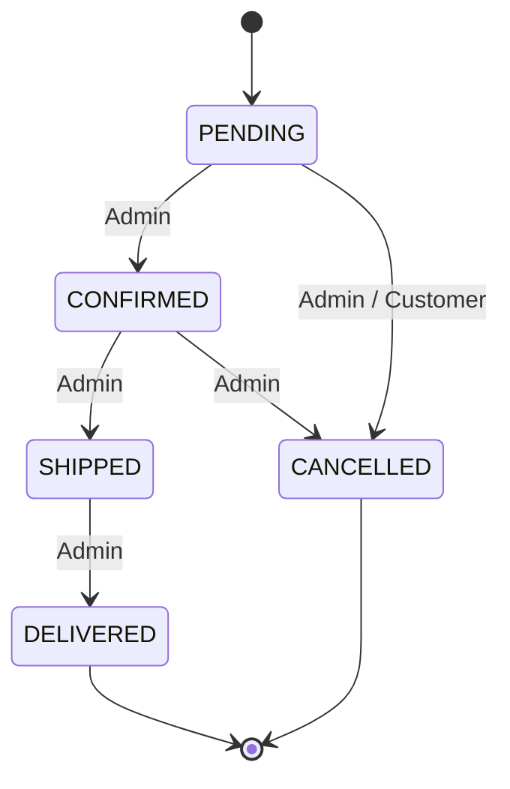

**Last synced with codebase:** Nov 04, 2026
Low-fidelity wireframes and user flows only. Business rules live in [[System Documentation]].

---

### Route Map

| Route                    | Access           | Page                         |
| ------------------------ | ---------------- | ---------------------------- |
| `/`                      | Public           | Storefront (product grid)    |
| `/products/:id`          | Public           | Product detail               |
| `/login`                 | Guest only       | Login                        |
| `/register`              | Guest only       | Register                     |
| `/cart`                  | Customer         | Cart                         |
| `/checkout`              | Customer         | Checkout                     |
| `/orders`                | Customer         | Order history                |
| `/orders/:id`            | Customer         | Order detail                 |
| `/profile`               | Customer         | Profile & password           |
| `/admin/products`        | Admin            | Product list / CRUD          |
| `/admin/categories`      | Admin            | Category list / CRUD         |
| `/admin/orders`          | Admin            | Order list                   |
| `/admin/orders/:id`      | Admin            | Order detail + status update |
| `/admin/customers`       | Admin            | Customer list (read-only)    |

---

## Flows

### Flow 1 — Auth & Token Lifecycle

```mermaid
flowchart TD
    A[Open app] --> B[POST /auth/refresh using cookie]
    B -->|200| C[Store access token in memory]
    B -->|401| D[Continue as Guest]
    C --> E{Role?}
    E -->|CUSTOMER| F[Storefront]
    E -->|ADMIN| G[/admin/products]
    H[API call returns 401 expired] --> I[POST /auth/refresh]
    I -->|200| J[Retry original request once]
    I -->|401| K[Clear state → /login]
```

### Flow 2 — Browse → Cart → Checkout

```mermaid
flowchart TD
    A[Storefront] --> B[Search / filter / sort]
    B --> C[Product detail]
    C --> D{Logged in?}
    D -->|No| E[/login] --> C
    D -->|Yes| F[Add to cart]
    F --> G[Cart page]
    G --> H[Update qty / remove]
    G --> I[Proceed to checkout]
    I --> J[Fill shipping form]
    J --> K[Place order - COD]
    K -->|201| L[Order detail - PENDING]
    K -->|409 INSUFFICIENT_STOCK| M[Show affected items → back to cart]
```

### Flow 3 — Order Status (Admin)



### Flow 4 — Admin Catalog Management

```mermaid
flowchart TD
    A[/admin/categories] --> B[Create category]
    B --> C[/admin/products]
    C --> D[Create product - pick category]
    D --> E[Edit / toggle active]
    E --> F{Delete?}
    F -->|Has orders| G[409 - suggest deactivate]
    F -->|No orders| H[Deleted]
```

---

## Wireframes

### W1 — Storefront (`/`)

```
┌──────────────────────────────────────────────────────────────┐
│ [Logo] CALI SHOP        [ Search products...      ]  🛒(2) 👤│
├──────────────────────────────────────────────────────────────┤
│ Categories: [All] [Pull-up Bars] [Rings] [Bands] [Apparel]   │
│                                        Sort: [Newest ▾]      │
├──────────────────────────────────────────────────────────────┤
│ ┌─────────┐  ┌─────────┐  ┌─────────┐  ┌─────────┐           │
│ │ [image] │  │ [image] │  │ [image] │  │ [image] │           │
│ │ Name    │  │ Name    │  │ Name    │  │ Name    │           │
│ │ ₱1,200  │  │ ₱850    │  │ ₱2,400  │  │ ₱600    │           │
│ │ [View]  │  │ [View]  │  │ OUT OF  │  │ [View]  │           │
│ │         │  │         │  │ STOCK   │  │         │           │
│ └─────────┘  └─────────┘  └─────────┘  └─────────┘           │
│                  « 1 2 3 »                                   │
└──────────────────────────────────────────────────────────────┘
```

### W2 — Product Detail (`/products/:id`)

```
┌──────────────────────────────────────────────────────────────┐
│ ← Back to shop                                               │
│ ┌──────────────┐   Gymnastic Rings (Wood)                    │
│ │              │   Category: Rings                           │
│ │   [image]    │   ₱1,850                                    │
│ │              │   In stock: 14                              │
│ └──────────────┘   Description text...                       │
│                    Qty: [ - ] 1 [ + ]                        │
│                    [        Add to Cart        ]             │
└──────────────────────────────────────────────────────────────┘
```

### W3 — Login / Register

```
┌──────────────────────────┐
│        Login             │
│ Email    [______________]│
│ Password [______________]│
│ [error message area]     │
│ [        Login        ]  │
│ No account? Register     │
└──────────────────────────┘
(Register adds: Name field + Confirm password)
```

### W4 — Cart (`/cart`)

```
┌──────────────────────────────────────────────────────────────┐
│ Your Cart                                                    │
│ ┌──────────────────────────────────────────────────────────┐ │
│ │ [img] Gymnastic Rings   ₱1,850   [-] 1 [+]   ₱1,850  [🗑]│ │
│ │ [img] Resistance Band   ₱600     [-] 2 [+]   ₱1,200  [🗑]│ │
│ └──────────────────────────────────────────────────────────┘ │
│                                   Subtotal:   ₱3,050         │
│                         [ Continue shopping ] [ Checkout ]   │
└──────────────────────────────────────────────────────────────┘
```

### W5 — Checkout (`/checkout`)

```
┌───────────────────────────────┬──────────────────────────────┐
│ Shipping Details              │ Order Summary                │
│ Recipient [_______________]   │ Gymnastic Rings x1  ₱1,850   │
│ Phone     [_______________]   │ Resistance Band x2  ₱1,200   │
│ Address   [_______________]   │ ──────────────────────────   │
│           [_______________]   │ Total              ₱3,050    │
│ Payment: (•) Cash on Delivery │                              │
│                               │ [      Place Order      ]    │
└───────────────────────────────┴──────────────────────────────┘
```

### W6 — Order History (`/orders`)

```
┌──────────────────────────────────────────────────────────────┐
│ My Orders                                                    │
│ ┌──────────────────────────────────────────────────────────┐ │
│ │ #1042   Nov 04, 2026   ₱3,050   [PENDING]   [View] [Cancel]│
│ │ #1031   Oct 21, 2026   ₱850     [DELIVERED] [View]       │ │
│ └──────────────────────────────────────────────────────────┘ │
└──────────────────────────────────────────────────────────────┘
```

### W7 — Admin Products (`/admin/products`)

```
┌────────┬─────────────────────────────────────────────────────┐
│ Admin  │ Products                       [ + New Product ]    │
│ ────── │ [Search...] [Category ▾]                            │
│ Products│ ┌─────────────────────────────────────────────────┐│
│ Categories│ Name        Category  Price  Stock  Active Actions││
│ Orders │ │ Rings       Rings     1,850  14     [on ]  ✎ 🗑  ││
│ Customers│ Band       Bands     600    0      [off]  ✎ 🗑  ││
│        │ └─────────────────────────────────────────────────┘│
└────────┴─────────────────────────────────────────────────────┘
```

### W8 — Admin Product Form (modal)

```
┌──────────────────────────────────┐
│ New Product                  [x] │
│ Name        [________________]   │
│ Category    [Select ▾]           │
│ Price (₱)   [______]  Stock [___]│
│ Image URL   [________________]   │
│ Description [________________]   │
│             [________________]   │
│ Active      [on]                 │
│ [ Cancel ]            [ Save ]   │
└──────────────────────────────────┘
```

### W9 — Admin Order Detail (`/admin/orders/:id`)

```
┌──────────────────────────────────────────────────────────────┐
│ ← Orders   Order #1042                       [PENDING]       │
│ Customer: Juan Dela Cruz  ·  0917 000 0000                   │
│ Ship to:  123 Sample St, Calamba, Laguna                     │
│ ┌──────────────────────────────────────────────────────────┐ │
│ │ Gymnastic Rings   ₱1,850  x1   ₱1,850                    │ │
│ │ Resistance Band   ₱600    x2   ₱1,200                    │ │
│ └──────────────────────────────────────────────────────────┘ │
│ Total ₱3,050                                                 │
│ [ Confirm Order ]  [ Cancel Order ]   (buttons depend on status)│
└──────────────────────────────────────────────────────────────┘
```

---

### UI States to Cover

| Screen            | Empty                         | Loading   | Error                                  |
| ----------------- | ----------------------------- | --------- | -------------------------------------- |
| Storefront        | "No products found"           | Skeletons | Retry banner                           |
| Cart              | "Your cart is empty" + link   | Skeleton  | Inline message                         |
| Orders            | "No orders yet"               | Skeleton  | Retry banner                           |
| Admin tables      | "Nothing here yet" + CTA      | Skeleton  | Toast with server `error.message`      |
| Forms             | —                             | Disable button + spinner | Field-level errors from `error.details` |

---

**Related docs:** [[System Documentation]] · [[Implementation Tracker]] · [[API Contracts/00-conventions]]
